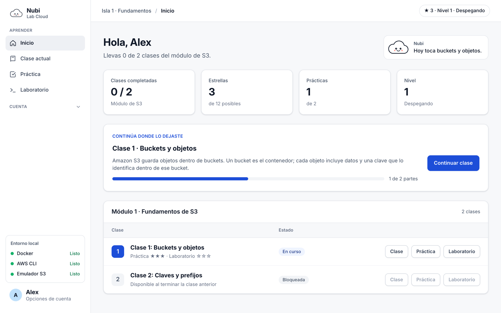
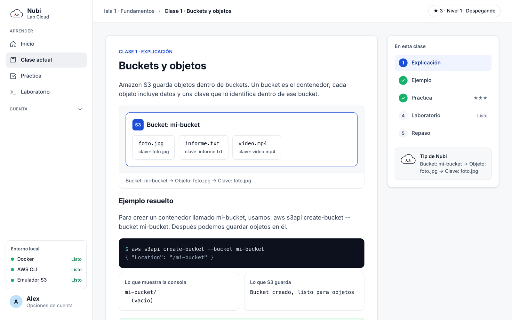
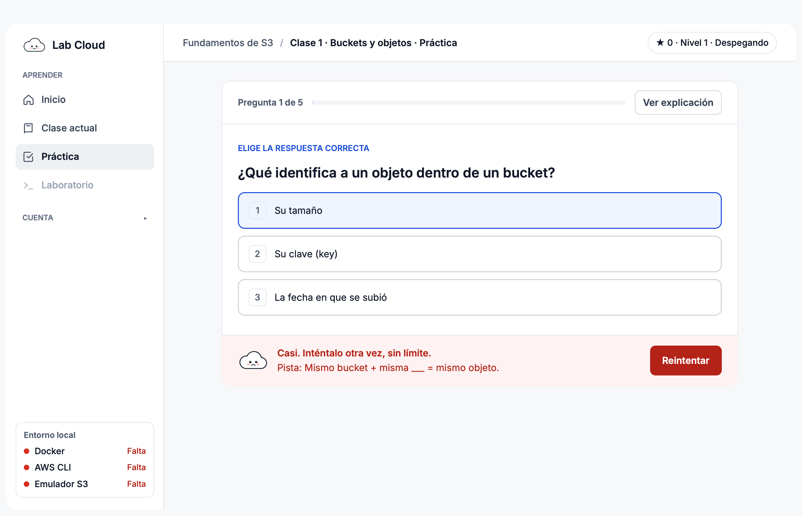
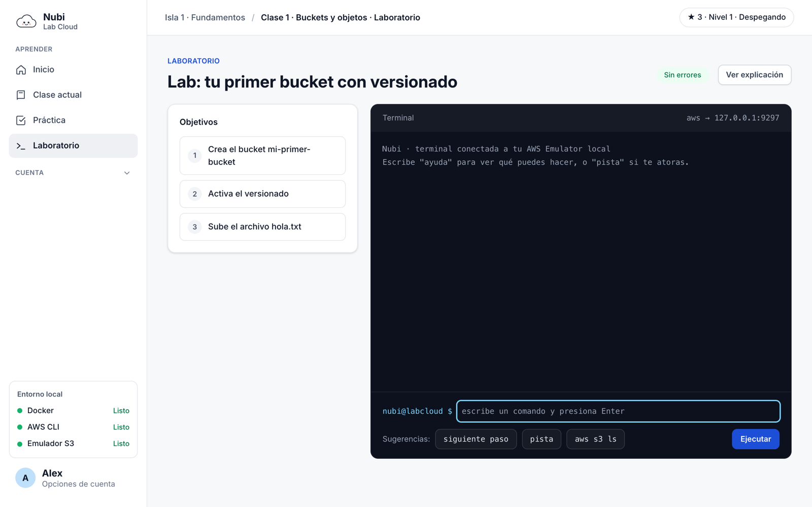
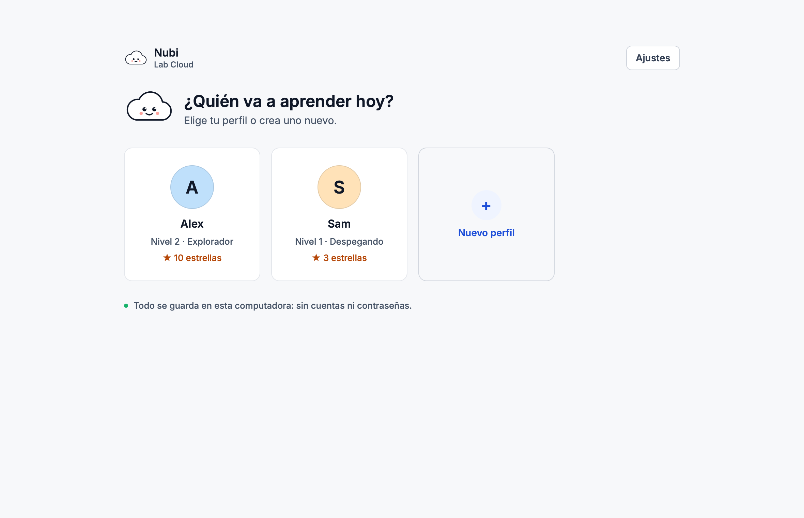
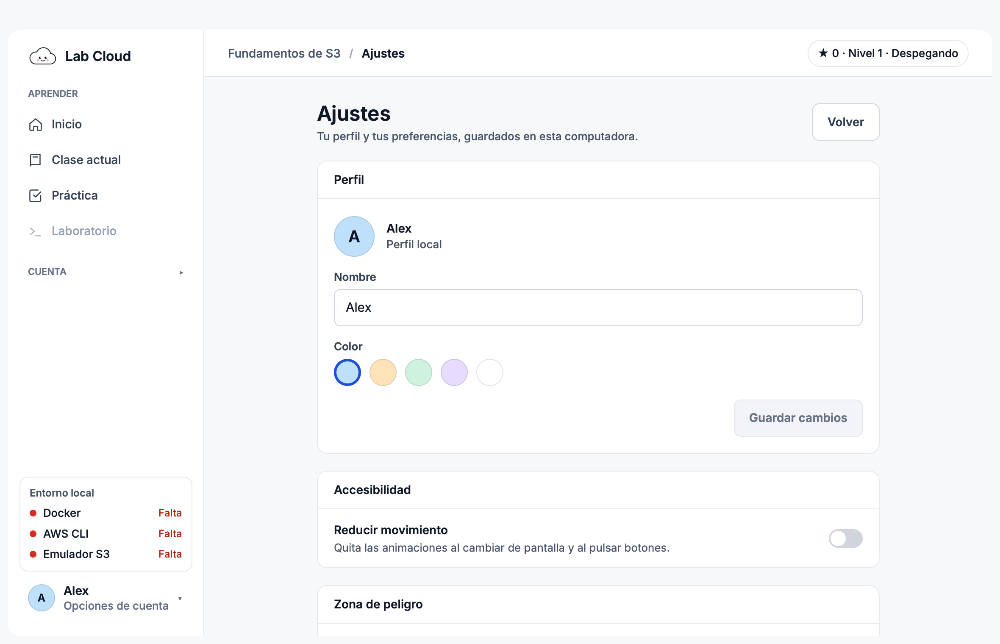

# Nubi

<p align="center">
  <a href="https://github.com/Leoglez10/nubi/actions/workflows/release.yml"></a>
  <a href="https://github.com/Leoglez10/nubi/releases/latest"></a>
  
  
  <a href="https://github.com/Leoglez10"></a>
</p>

<p align="center">
  
  
  
  
  
  
</p>

Nubi (Lab Cloud) is a desktop app to learn AWS in Spanish, one guided class at a time, with every hands-on lab
running on your own machine against the local [AWS Emulator](https://github.com/aws/aws-emulator).
No AWS account, no cloud bill, no passwords.



## What it is

Nubi teaches AWS fundamentals the way a short course would: each **class** explains one
idea with drawings and a worked example, then you **practice** with quick questions, then you
run real `aws` commands in a **lab** terminal built into the app. Your progress is saved
locally as stars, and you can replay anything to perfect it.

It is for people starting with AWS who prefer to learn by doing, in Spanish. The app's copy
and all course content are in Spanish.

## Features

- **Guided classes**: explanation → worked example → practice → lab → review. You can reopen
  the explanation in the middle of a practice or lab without losing your attempt.
- **Practice** with four exercise types: multiple choice, write the command, put steps in
  order, and match pairs. Unlimited retries with a hint after each mistake.
- **Labs** with an integrated terminal that runs only `aws` commands (no shell) against the
  local emulator, live objectives that check the real emulator state, suggestions, and
  `ayuda` / `pista` commands.
- **Mastery instead of penalties**: each stop records its best result as 1–3 stars
  (3 = zero errors). Total stars give your level. No lives, no streaks.
- **Local profiles**: several people can learn on the same computer; each profile keeps its
  own progress and its reduced-motion preference.
- **Guided setup**: on start the app checks Docker, the AWS CLI and the emulator, and offers a
  one-click fix for whatever is missing.
- **Nubi**, the cloud mascot, greets you, gives a tip in each class and reacts to your answers.
- **Accessible motion**: a reduced-motion switch in Ajustes; the operating system's
  reduced-motion setting is always honored.

## Screenshots

| Class | Practice |
|---|---|
|  |  |
| **Lab** | **Profiles** |
|  |  |
| **Settings** | |
|  | |

## Course content today

One unit, **Fundamentos de S3**, with two classes:

1. **Buckets y objetos** — explanation and worked example → practice → versioning lab → review.
2. **Claves y prefijos** — explanation and worked example → practice → two-file archive lab → review.

Complete a class's practice to unlock its lab, and a class's lab to unlock the next class.
IAM/STS, DynamoDB, SQS and SNS are planned next; see [PLAN.md](PLAN.md).

## Download

Get the app for macOS (`.dmg`), Windows (`.exe`) or Linux (`.deb`, `.AppImage`) from the
[latest release](https://github.com/Leoglez10/nubi/releases/latest) or the
[website](https://leoglez10.github.io/nubi/). You still need Docker and AWS CLI v2.
Builds are not signed yet: on macOS, try to open the app once and then choose
**Open Anyway** in System Settings → Privacy & Security; on Windows, choose
**More info → Run anyway** in SmartScreen.

## Quick start (from source)

Requirements:

- [Rust](https://rustup.rs) (stable, edition 2024)
- [Node.js](https://nodejs.org) 24 with npm
- The [Tauri v2 system prerequisites](https://v2.tauri.app/start/prerequisites/) for your OS
  (on Linux, WebKitGTK 4.1 and friends)
- [Docker](https://www.docker.com/products/docker-desktop/), running
- [AWS CLI v2](https://docs.aws.amazon.com/cli/latest/userguide/getting-started-install.html)

```sh
git clone https://github.com/Leoglez10/nubi.git
cd nubi
npm ci --prefix ui
ui/node_modules/.bin/tauri dev
```

The first start checks your machine. If something is missing, the setup screen shows a
button that installs or starts it (Homebrew on macOS, winget on Windows, or the official
download page), and builds and starts the emulator for you.

## Using the app

1. **Pick or create a profile.** A name and a color; nothing leaves your computer.
2. **Inicio** shows your progress, the class to continue and the module table.
3. **Open a class.** Read the explanation, then press **Empezar práctica**.
4. **Practice.** Choose or type the answer and press **Comprobar**. A wrong answer shows a
   hint; retry as many times as you like. **Ver explicación** reopens the class.
5. **Lab.** Type `aws` commands in the terminal and press Enter. Objectives tick off as the
   emulator reaches the required state. Type `pista` if you are stuck.
6. **Perfect it.** Replay any practice or lab from scratch to reach three stars.

The sidebar moves between **Inicio**, **Clase actual**, **Práctica** and **Laboratorio** and
resumes an attempt in progress instead of restarting it. **Cuenta** (or your profile at the
bottom of the sidebar) opens **Ajustes**, **Cambiar de perfil** and **Cerrar sesión**.

In **Ajustes** you can rename your profile, change its color, turn on reduced motion, or
delete the profile after a confirmation.

## Your data

Everything stays on your computer, in the OS app-data folder. The folder keeps the
app's former name, `LabCloud`, so profiles created before the rename to Nubi are kept:

| OS | Folder |
|---|---|
| macOS | `~/Library/Application Support/LabCloud/` |
| Windows | `%APPDATA%\LabCloud\` |
| Linux | `$XDG_DATA_HOME/labcloud/` (default `~/.local/share/labcloud/`) |

Inside it, `profiles/<id>/profile.json` holds the name, color and motion preference, and
`profiles/<id>/progress.json` holds the stars of each stop. Files are written atomically
(a crash leaves the old file or the new one), and a corrupt progress file is reported and
never silently overwritten. Lab working folders live under `labs/<id>/`.

- **Backup:** copy the `LabCloud` folder while the app is closed.
- **Delete a profile:** Ajustes → Zona de peligro → Eliminar perfil. It removes that
  profile's folder and its progress permanently.

The emulator listens only on `127.0.0.1:9297` and keeps its resources in memory: stopping it
erases buckets and objects created in labs (your stars are not affected).

## Managing the emulator by hand

The app starts the emulator for you, but you can also use the script:

```sh
scripts/emulator.sh start   # build the image once and start it on 127.0.0.1:9297
scripts/emulator.sh stop    # stop it (its resources are lost)
eval "$(scripts/emulator.sh env)"   # point the AWS CLI in your shell at the emulator
```

The image is built from [`emulator/Dockerfile`](emulator/Dockerfile), which follows the
official AWS Emulator Docker recipe for `aarch64` or `x86_64`.

## Troubleshooting

| Problem | What to do |
|---|---|
| The setup screen says Docker is missing or stopped | Install Docker Desktop or start it, then press **Comprobar de nuevo**. On Linux, start it with `sudo systemctl start docker`. |
| The emulator does not become ready | Run `scripts/emulator.sh start` to see the error, then `docker logs labcloud-emulator`. |
| A lab objective does not tick | Check the exact bucket and key names in the objective; type `pista`. Replaying the lab resets its resources. |
| "No se pudo crear el perfil" | Names must have 1 to 40 characters. |
| Progress did not load | The app found a progress file it could not read and left it untouched; check `progress.json` in the data folder. |

## For developers

**Stack:** a Rust engine (the `nubi` library, edition 2024: course, grading, progress, labs,
setup) with `aws-sdk-s3` and `tokio` to check lab objectives against the emulator and
`serde`/`toml`/`serde_json` for content and progress; a [Tauri v2](https://v2.tauri.app) app
crate in `src-tauri/` that exposes the engine as commands; and the UI in `ui/`, React +
TypeScript + Vite.

```sh
npm ci --prefix ui                          # once: the UI dependencies and the Tauri CLI
ui/node_modules/.bin/tauri dev              # the app, with hot reload (from the repo root)
npm --prefix ui run dev                     # the UI alone in a browser, with sample data
cargo test --workspace                      # engine and command tests
cargo test --workspace -- --include-ignored # also the tests that need the emulator running
npm --prefix ui test                        # UI tests (Vitest + Testing Library)
cargo clippy --workspace --all-targets -- -D warnings
ui/node_modules/.bin/tauri build            # installers for this OS under target/release/bundle/
```

Releases: push a `v*` tag (for example `git tag v0.1.0 && git push origin v0.1.0`) and
`.github/workflows/release.yml` builds with the Tauri bundler the macOS universal `.dmg`, the
Windows installer `.exe` (NSIS) and the Linux `.deb`/`.AppImage`, and attaches them to a
GitHub Release. Course
content is embedded in the binary at build time by `build.rs`. The website lives in `docs/`
(GitHub Pages, `main` branch, `/docs` folder).

### Project structure

```text
src/               the engine (`nubi` library)
├── lib.rs         module list
├── course.rs      loads and validates the course TOML
├── lesson.rs      a practice session: answers, feedback, mistakes
├── lab.rs         a lab session: terminal history, aws command parsing, objectives
├── checker.rs     checks lab objectives against the emulator with the AWS SDK
├── grading.rs     stars, levels, unlock order
├── progress.rs    local profiles and progress on disk
├── setup.rs       what the machine is missing and how to fix it per OS
└── emulator.rs    emulator health and AWS CLI environment
src-tauri/         the Tauri app crate (binary `nubi`): engine.rs wraps the engine as
                   commands, main.rs registers them; tauri.conf.json, icons/
ui/                React + TypeScript + Vite UI
├── src/api/       typed client for the Tauri commands (sample data in the browser)
├── src/shell/     sidebar, top bar, transitions
└── src/screens/   intro, setup, profiles, settings, Inicio, class, practice, lab
content/           course.toml and one TOML per lesson or lab (Spanish)
assets/            app icon sources (icon.svg, icon.png)
emulator/          Dockerfile for the AWS Emulator image
scripts/           emulator.sh
tests/             engine integration tests (content, classes, emulator, checker)
docs/screenshots/  images used in this README
odd/tasks/         feature logbooks
```

### Adding content

Course content is Spanish TOML under `content/`; no code changes are needed:

- `content/course.toml` — the course order: units and the ids of their stops, in order.
- `content/lessons/<id>.toml` — one stop. `kind` is `leccion`, `lab` or `desafio`.
  - Lessons and challenges list `[[exercises]]` with `type`: `choice` (`options`, `answer`
    index), `command` (`answers`), `order` (`steps` in the right order) or `match`
    (`pairs` in the right order). Each has a `prompt` and a `hint`.
  - A lesson's optional `[teaching]` table defines a guided class: `number`, `title`,
    `lab` (the next lab id in the course), `explanation`, `visual`, `example`, `review`
    and an optional `diagram` (`bucket_objects` or `key_prefixes`). Class numbers follow
    course order starting at 1; all teaching strings must be nonempty.
  - Labs list `[[objectives]]` with `text`, `hint` and a `check`: `bucket_exists`,
    `bucket_versioning` (`status`) or `object_exists` (`key`).

`cargo test --workspace` validates every file (ids, answers in range, labs with objectives, class order).

## Status

Early and in active development (version 0.1.2, not published as a crate). Only S3 is covered
so far.

## Credits

- [AWS Emulator](https://github.com/aws/aws-emulator) runs every lab locally.
- [Tauri](https://v2.tauri.app) runs the desktop app and [React](https://react.dev) draws
  its UI.

## License

[MIT](LICENSE).
